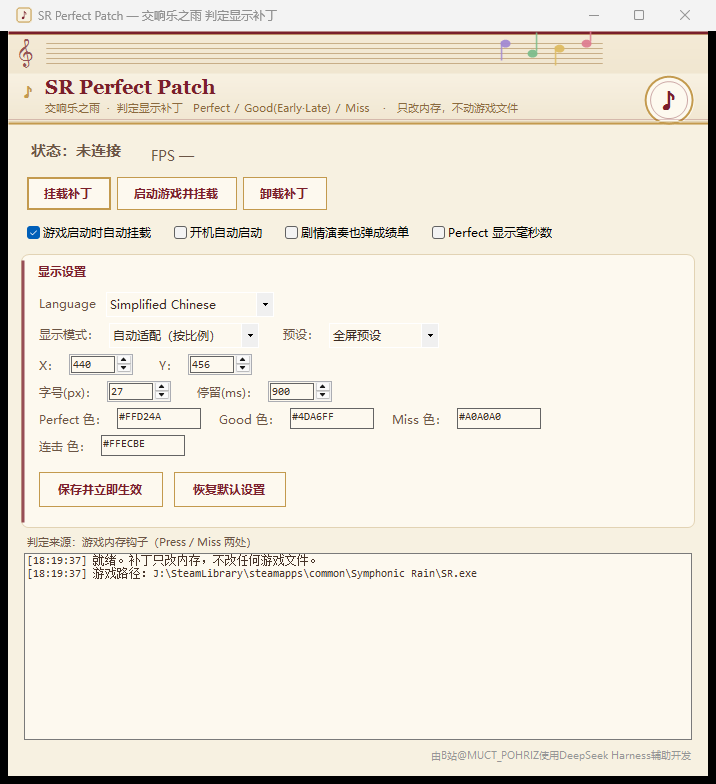

# SR Perfect Patch

[English](README.md) | **简体中文**

给《交响乐之雨》（シンフォニック＝レイン / Symphonic Rain，工画堂スタジオ）音游小游戏
用的**只读内存覆盖层**。

游戏本身从不告诉你「这一下到底算不算准」——只有一个分数和几盏含义模糊的灯。
这个工具把游戏自己刚算出来的判定读出来，画在游戏画面上：`Perfect` / `Good (Early 37 ms)` /
`Miss`、当前连击、实时帧率，以及一曲结束后的完整成绩单。

> **不改动任何一个游戏文件。** 不写盘、不重打包、不往游戏目录放 DLL。
> 一切都在内存里，断开或游戏退出时逐字节还原。



## 支持的版本

| 版本 | 可执行文件 | 说明 |
|---|---|---|
| Steam 版（2023 重发） | `SR.exe`，3,371,472 字节，MFC 构建 | 通过 Steam 库目录自动查找 |
| 2007 流行版 | `SR.EXE`，2,324,480 字节，Delphi 构建（常见破解名 `[交响乐之雨].SR_Cracked.exe` / `[交响乐之雨].SR.exe`） | 需自己先启动游戏，再点「挂载补丁」 |

两个版本按进程名识别，再对每个钩子点逐字节校验；对不上就只提示
「字节不匹配，未做任何写入」，绝不改动游戏。

## 功能

| 功能 | 说明 |
|---|---|
| 实时判定文字 | `Perfect`（金）/ `Good`（蓝）/ `Miss`（灰），Good 带 `Early/Late` 与毫秒数 |
| 连击 | 与副行同字号、同基线并排显示当前连击 |
| AP 角标 | 从开场到第一次非 Perfect 判定之前，`Perfect` 右侧显示小号 `AP` |
| 成绩单 | 一曲弹完淡入：Perfect / Good（分 Early、Late）/ Miss / Score |
| `★ ALL PERFECT ★` | 没有 Good / Miss / 空按，或分数达到该曲理论最高分时，成绩单标题下多一行 |
| 实时帧率 | 显示游戏每帧更新判定逻辑的频率，只在演奏中出现 |
| 默认只统计 Free Play | 剧情里的演奏默认不弹成绩单，可在界面勾选 |
| Perfect 也显示毫秒 | 可选，默认关闭 |
| 分辨率适配 | 自动按比例缩放；也可锁定全屏 / 窗口预设（2007 版使用独立锚点） |
| 三语界面 | 简体中文 / English / 日本語，可运行时切换 |
| 托盘与热键 | F7 预览成绩单、F8 自检、F9 重载配置、F10 显隐、`Ctrl+Alt+方向键` 微调 |
| 记住窗口大小 | 关闭时写回 `config.ini` |
| 自动挂载 | 游戏一出现就挂上，退出自动卸载 |

## 运行要求

* Windows 10 / 11，**x64**
* 上表两个版本之一。程序会校验每个钩子点的原始指令字节，不匹配即拒绝。

除此之外不需要任何东西：发布版是自包含单文件，不用装 .NET 运行时。

## 快速开始

1. 双击 `SRPerfectPatch.exe`。
2. Steam 版会自动找到游戏并挂载；2007 版先自己启动游戏，再点「挂载补丁」。
3. 在游戏里进入 **Free Play** 选曲，判定文字就出现在粉灯右侧、五线谱上方。
4. 弹完一曲 → 成绩单淡入。

卸载 = 点「卸载补丁」，或直接关游戏（自动还原）。磁盘上除了本工具自己的
`config.ini` 不会留下任何东西。

## 热键

| 键 | 作用 |
|---|---|
| `F7` | 预览成绩单（普通样板 / ALL PERFECT 样板交替） |
| `F8` | 自检：轮流显示 Perfect(+AP) / Good / Miss |
| `F9` | 重载 `config.ini`，不用重启 |
| `F10` | 显示 / 隐藏覆盖层 |
| `Ctrl+Alt+←/→/↑/↓` | 判定文字微调 2px |
| `Ctrl+Alt+[` / `]` | 字号 −1 / +1 |
| `Ctrl+Alt+S` | 保存当前微调 |

## 判定窗口

| 版本 | Perfect | Good | Bad | 时间基准 |
|---|---|---|---|---|
| Steam 版 | ±13.33 ms | ±53.33 ms | ±106.67 ms | 1/88200 s，1176 = 1/75 s |
| 2007 流行版 | ±20 ms | ±80 ms | ±160 ms | 1/88200 s，1764 = 1/50 s |

窗口是编译期常量，与分辨率无关；实际容差还会被帧率量化——帧率越低略宽，绝不会更窄。

## 配置（`config.ini`）

```ini
[behavior]
autoattach=1              ; 游戏一出现就挂载
storysummary=0            ; 剧情里的演奏是否也弹成绩单
showperfectms=0           ; Perfect 是否也显示 Early/Late 与毫秒
fitmode=auto              ; auto | full | window
x=440 / y=456             ; 游戏客户区内的锚点
xwin=440 / ywin=444
x2007=268 / y2007=303     ; 2007 版专用锚点
fontsize=27               ; fontwin=26, font2007=18
fadems=900
colorperfect=#FFD24A
colorgood=#4DA6FF
colormiss=#A0A0A0
colorcombo=#FFECBE
showcombo=1
clickthrough=1
language=zh               ; zh | en | ja
windowwidth=0 / windowheight=0   ; 0 = 自动
```

`fitmode=auto` 时按 `客户区高度 / 720` 缩放锚点与字号，所以全屏 1280×720 与窗口
1280×701 下文字都停在同一处乐谱位置。2007 版不缩放（两版布局非等比），
直接用 `x2007` / `y2007` / `font2007`。

## 原理（简版）

游戏的判定代码在加密的 `.text` 里，所以工具附着到运行中的进程，在几处指令上写短跳转，
跳到它自己分配的代码洞。所有地址都来自按版本划分的配置档：

* **Steam 版**：按键 `0x053B34`、漏音 `0x0536FE`、每帧更新 `call 0x05056A → 0x053330`
* **2007 版**：按键 `0x044804`、漏音 `0x044387`、每帧更新 `call 0x04146C → 0x044130`

按键钩子把档位（0..3）、键位、音符序号与带符号时间差写进 128 槽环形缓冲；
覆盖层 UI 线程每 16ms 轮询这个缓冲，用 `UpdateLayeredWindow` 画在游戏前台窗口上。

安全设计见 [docs/SECURITY.md](docs/SECURITY.md)，内部细节见
[docs/ARCHITECTURE.md](docs/ARCHITECTURE.md)。要点：

* 进程权限只要 `VM_READ | VM_WRITE | VM_OPERATION | QUERY_INFORMATION`，**不是**
  `ALL_ACCESS`；无线程注入、无 `CreateRemoteThread`、无 `SetWindowsHookEx`、无任何网络代码。
* 每个钩子点在写入前逐字节校验；不匹配 → 立即中止，零写入。
* 改写期间挂起全部游戏线程，写完恢复。
* 代码洞的代码页 `PAGE_EXECUTE_READ`、数据页 `PAGE_READWRITE`（W^X），绝不用 RWX。
* 用 magic 标记识别自己的代码洞；来路不明的内存永不释放。
* 卸载时写回原始字节并恢复原页保护（execute+read）。
* 本工具崩溃不影响游戏；补丁会留在内存里，下次启动直接接管（不会重复挂钩）。

## 从源码构建

```powershell
cd src
dotnet build -c Release                    # 公开版（无美术）
dotnet publish -c Release -r win-x64 --self-contained true `
    -p:PublishSingleFile=true -o ..\dist   # 单文件发布
```

本仓库**不含任何游戏素材**：顶部装饰由代码绘制（纸面、酒红细线、五线谱、来自
Segoe UI Symbol 的高音谱号字形），图标也是程序生成的。如果 `.csproj` 旁边存在
`frame_top.png` / `header_icon.png`，构建会自动切到嵌入它们的「美术版」——那只是自用变体。

## 更新日志

见 [docs/CHANGELOG.md](docs/CHANGELOG.md)。

## 版权与免责

* 《交响乐之雨》© 工画堂スタジオ（Kogado Studio）。本项目为第三方工具，与其无隶属或背书关系，
  **不附带**任何游戏数据、美术、音乐或文本。
* 工具只读取它附着的游戏进程，供练习与了解判定系统使用。风险自负，无任何担保，见 [LICENSE](LICENSE)。
* 喜欢的话请支持正版。

## 致谢

* 作者 **MUCT_POHRIZ**（bilibili），开发过程由 **DeepSeek Harness** 辅助。
* 判定窗口、计分公式与内部结构均来自对游戏自身代码的运行时逆向（具体数值见
  [docs/ARCHITECTURE.md](docs/ARCHITECTURE.md)）。

## 许可

[MIT](LICENSE)
