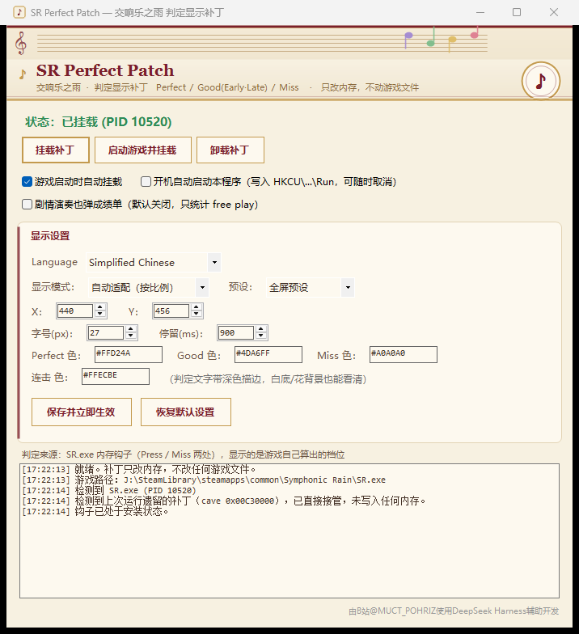

# SR Perfect Patch

**English** | [简体中文](README.zh-CN.md)

A read-only memory overlay for the rhythm ("music action") mini-game in
**Symphonic Rain** (シンフォニック＝レイン, Kogado Studio).

The 2004 original never tells you *how* you were judged — only a score number and
a vague lamp. This tool reads the judgement the game itself just computed and
draws it on top of the game, so you can see `Perfect` / `Good (Early 37 ms)` /
`Miss`, the current combo, and a full result card when the song ends.

> **It does not modify a single game file.** No patching on disk, no repacking,
> no added DLL in the game folder. Everything happens in RAM, and is reverted
> byte-for-byte when you disconnect or when the game exits.



## Features

| Feature | Detail |
|---|---|
| Live judgement text | `Perfect` (gold) / `Good` (blue) / `Miss` (grey), with `Early`/`Late` **and milliseconds** |
| Combo | Current combo counter, same size and baseline as the sub-line |
| Result card | After a complete performance: Perfect / Good (split into Early & Late) / Miss / Score, faded in |
| Free-play only by default | Story-mode performances do not pop the card unless you tick the box |
| Resolution aware | Auto-scales to any client size; or pin to a fullscreen / windowed preset |
| Three languages | 简体中文 / English / 日本語, switchable at runtime |
| Tray + hotkeys | F7 preview card, F8 self-test, F9 reload config, F10 show/hide overlay |
| Remembers window size | Saved back to `config.ini` on close |
| Auto attach | Starts with the game, detaches when it exits |

## Requirements

* Windows 10 / 11, **x64**
* The Steam release of Symphonic Rain (2023 re-release, `SR.exe`, 3,371,472 bytes).
  The tool verifies the exact instruction bytes at both hook sites and refuses to
  touch anything that does not match — a different build simply gets "bytes
  mismatch, nothing was written".

Nothing else. The release build is a self-contained single `.exe`; no .NET runtime
installation needed.

## Quick start

1. Run `SRPerfectPatch.exe`.
2. It finds the game via the Steam library folders and attaches automatically
   (or press **Attach patch** yourself).
3. Start a song in **Free Play** in the game. Judgement text appears next to the
   pink lamp, above the staff.
4. Play the song to the end → the result card fades in.

Uninstalling = press **Detach patch**, or just close the game (the patch is
released automatically). There is nothing installed on disk except this tool's
own `config.ini`.

## Hotkeys

| Key | Action |
|---|---|
| `F7` | Preview the result card with sample numbers |
| `F8` | Self-test: cycles Perfect / Good / Miss overlay samples |
| `F9` | Reload `config.ini` without restarting |
| `F10` | Show / hide the overlay |

## Configuration (`config.ini`)

```ini
[behavior]
autoattach=1              ; attach when SR.exe appears
storysummary=0            ; 1 = also show result card in story performances
fitmode=auto              ; auto | full | window
x=440 / y=456             ; anchor inside the game client area
fontsize=27
fadems=900
colorperfect=#FFD24A
colorgood=#4DA6FF
colormiss=#A0A0A0
colorcombo=#FFECBE
showcombo=1
clickthrough=1
language=zh               ; zh | en | ja
windowwidth=0 / windowheight=0   ; 0 = auto
```

`fitmode=auto` scales the anchor and font by `client_height / 720`, so the text
stays in the same musical position whether you play fullscreen (1280×720) or
windowed (1280×701).

## How it works (short version)

The game's judgement routine lives in an encrypted `.text` section, so the tool
attaches to the running process and hooks two instructions with a 6-byte jump
into a small code cave it allocates in the process:

* `SR.exe+0x053B34` — the press handler, right where the grade (0..3) has been
  computed. The hook copies the grade, the key index, the note index and the
  signed time delta into a 128-slot ring buffer.
* `SR.exe+0x0536FE` — the missed-note path, which reports "note went by unhit".

The UI thread of this tool polls the ring buffer every 16 ms and renders an
`UpdateLayeredWindow` overlay that follows the game's foreground window.

Safety measures are described in [docs/SECURITY.md](docs/SECURITY.md), and the
internals in [docs/ARCHITECTURE.md](docs/ARCHITECTURE.md). Summary:

* `PROCESS_VM_READ | PROCESS_VM_WRITE | PROCESS_VM_OPERATION | QUERY_INFORMATION`
  — **not** `ALL_ACCESS`; no thread injection, no remote `CreateRemoteThread`,
  no `SetWindowsHookEx`, no network code at all.
* Both hook sites are byte-verified before writing; mismatch → abort with zero
  writes.
* All game threads are suspended while the 6 bytes are swapped, then resumed.
* The code cave is `PAGE_EXECUTE_READ` and its data page is `PAGE_READWRITE`
  (W^X), never RWX.
* A magic tag identifies our own cave; anything unrecognised is never freed.
* Uninstall restores the original bytes and restores the original page
  protection (execute+read).
* If this tool crashes, the game keeps running; the patch is simply left in place
  and is adopted on the next start (no double hooking).

## Building from source

```powershell
cd src
dotnet build -c Release                    # public (no-art) build
dotnet publish -c Release -r win-x64 --self-contained true `
    -p:PublishSingleFile=true -o ..\dist   # single-file release
```

This repository contains **no game assets**: the header decoration is drawn in
code (paper, wine-red rule, staff lines, a treble-clef glyph from Segoe UI
Symbol) and the icon is generated programmatically. If you happen to place
`frame_top.png` / `header_icon.png` next to the `.csproj`, the build switches to
the "art build" that embeds them — that variant is for personal use only.

## Legal / disclaimer

* Symphonic Rain is © Kogado Studio / 工画堂スタジオ. This project is unofficial,
  not affiliated with or endorsed by them, and ships **no** game data, art,
  music or text.
* The tool only reads the game process it attaches to. It is intended for
  practice and for understanding the judgement system. Use at your own risk —
  no warranty of any kind, see [LICENSE](LICENSE).
* Please buy the game if you want to play it.

## Credits

* Made by **MUCT_POHRIZ** (bilibili), with assistance from **DeepSeek Harness**.
* Judgement windows, scoring formula and internal layout were obtained by
  reverse-engineering the game's own code at runtime (see
  [docs/ARCHITECTURE.md](docs/ARCHITECTURE.md) for the numbers).

## License

[MIT](LICENSE)
