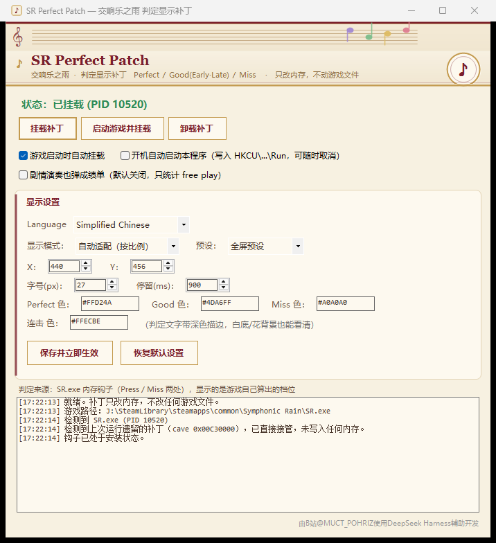

# SR Perfect Patch

**简体中文** | [English](README.md)

一个给《交响乐之雨》音乐小游戏（music action）用的**只读内存覆盖层**。

原版 2004 年的游戏从不告诉你判定结果，只给一个分数和几盏灯。这个工具读取游戏
**自己算出来的判定**，直接叠在画面上显示：`Perfect` / `Good (Early 37 ms)` /
`Miss`、当前连击，完整演奏后还会弹出成绩单。

> **不修改任何游戏文件。** 不写盘、不重打包、不往游戏目录塞 DLL。
> 全部动作都在内存里，断开或游戏退出时会逐字节还原。



## 功能

| 功能 | 说明 |
|---|---|
| 实时判定 | `Perfect`（金）/ `Good`（蓝）/ `Miss`（灰），Good 额外显示 `Early`/`Late` **与毫秒数** |
| 连击 | 实时连击数，字号与基线跟副行完全一致 |
| 成绩单 | 完整演奏结束后淡入：Perfect / Good（分 Early、Late）/ Miss / Score |
| 默认只认自由演奏 | 剧情里的演奏不弹成绩单（可在界面勾选放开） |
| 分辨率自适应 | 任意客户区尺寸自动按比例缩放；也可锁定全屏 / 窗口两套绝对预设 |
| 三语 | 简体中文 / English / 日本語，运行中可切换 |
| 托盘 + 热键 | F7 预览成绩单、F8 自检、F9 重载配置、F10 显隐 |
| 记住窗口大小 | 关闭时写回 `config.ini` |
| 自动挂载 | 游戏启动自动接上，游戏退出自动卸载 |

## 运行要求

* Windows 10 / 11，**x64**
* Steam 版《交响乐之雨》（2023 年重发，`SR.exe` 3,371,472 字节）。
  程序会在写入前逐字节校验两个钩子点的原始指令，版本对不上就拒绝改动
  （提示「字节不匹配，未写入任何内存」）。

不再需要别的。Release 里是自包含单文件 exe，不用装 .NET 运行时。

## 三步开始

1. 运行 `SRPerfectPatch.exe`；
2. 它会从 Steam 库目录找到游戏并自动挂载（也可手动点「挂载补丁」）；
3. 在游戏里进 **Free Play** 开一首歌 —— 判定文字就出现在粉色提示灯右侧、五线谱上方。

想彻底撤掉：点「卸载补丁」，或直接关掉游戏（会自动还原）。磁盘上除了它自己的
`config.ini` / `patch.log` 什么都没留。

## 热键

| 键 | 作用 |
|---|---|
| `F7` | 用示例数字预览成绩单 |
| `F8` | 自检：轮播 Perfect / Good / Miss 三种样式 |
| `F9` | 重载 `config.ini`，不用重启 |
| `F10` | 显示 / 隐藏覆盖层 |

## 配置（`config.ini`）

```ini
[behavior]
autoattach=1              ; 游戏一出现就挂载
storysummary=0            ; 1 = 剧情里的演奏也弹成绩单
fitmode=auto              ; auto | full | window
x=440 / y=456             ; 锚点（相对游戏客户区）
fontsize=27
fadems=900
colorperfect=#FFD24A
colorgood=#4DA6FF
colormiss=#A0A0A0
colorcombo=#FFECBE
showcombo=1
clickthrough=1
language=zh               ; zh | en | ja
windowwidth=0 / windowheight=0   ; 0 = 自动
```

`fitmode=auto` 会按 `客户区高度 / 720` 缩放锚点与字号，所以全屏（1280×720）和
窗口（1280×701）下文字都停在五线谱的同一位置上。

## 原理（简述）

游戏的判定代码在加密的 `.text` 里，所以本工具附着到运行中的进程，用一条 6 字节
跳转把两个指令钩到自己在进程内申请的小代码洞里：

* `SR.exe+0x053B34` —— 按键判定处，正好是档位（0..3）算完的那一刻。钩子把档位、
  键位、音符号、带符号的时间差写进 128 槽的环形缓冲。
* `SR.exe+0x0536FE` —— 漏音结算处，回报「这个音符过去了没被弹」。

工具的界面线程每 16 ms 读一次环形缓冲，用 `UpdateLayeredWindow` 画一层跟随游戏
前台窗口的透明覆盖层。

安全设计详见 [docs/SECURITY.md](docs/SECURITY.md)，内部细节见
[docs/ARCHITECTURE.md](docs/ARCHITECTURE.md)。要点：

* 打开进程只要 `VM_READ|VM_WRITE|VM_OPERATION|QUERY_INFORMATION`，**不是**
  `ALL_ACCESS`；无 `CreateRemoteThread`、无 `SetWindowsHookEx`、无任何网络代码。
* 两处钩子点写入前逐字节校验，不符即中止且零写入。
* 改写 6 字节期间挂起游戏全部线程，写完再恢复。
* 代码洞是 `PAGE_EXECUTE_READ`、数据页是 `PAGE_READWRITE`（W^X），从不 RWX。
* 用 magic 标记识别自己的代码洞，来历不明的一律不释放。
* 卸载时还原原始字节与原始页属性。
* 本工具崩溃不会连累游戏；补丁留在内存里，下次启动会「接管」而不是重复钩。

## 从源码构建

```powershell
cd src
dotnet build -c Release                    # 公开版（无美术）
dotnet publish -c Release -r win-x64 --self-contained true `
    -p:PublishSingleFile=true -o ..\dist   # 单文件发布
```

本仓库**不含任何游戏素材**：顶部装饰是代码画的（纸色、酒红细线、五线谱、Segoe UI
Symbol 的高音谱号字形），图标也是程序生成的。只有当你在 `.csproj` 同级放上
`frame_top.png` / `header_icon.png` 时，构建才会切到「带美术版」——那个仅供自用。

## 法律与免责

* 《交响乐之雨》版权归 Kogado Studio / 工画堂スタジオ 所有。本项目是非官方的，
  与版权方无关，也**不包含**任何游戏数据、美术、音乐或文本。
* 工具只读取它所附着的游戏进程，用于练习与理解判定系统。使用风险自负，无任何
  担保，详见 [LICENSE](LICENSE)。
* 想玩请购买正版。

## 致谢

* 作者：**MUCT_POHRIZ**（B 站），使用 **DeepSeek Harness** 辅助开发。
* 判定窗口、计分公式与内部结构，是在运行时逆向游戏自身代码得到的
  （数字见 [docs/ARCHITECTURE.md](docs/ARCHITECTURE.md)）。

## 许可

[MIT](LICENSE)
